# Valid-But-Wrong

**A CRC tells you the bits arrived intact. It doesn't tell you they're true.**

A man-in-the-middle on a telemetry link rewrites the values in each frame and recomputes a valid CRC, so every
frame passes the link checks: sync marker, CRC-16, sequence number, mission clock. The operator's screen shows a
rocket that is kilometres from where it really is, and nothing on the link looks wrong.

Valid-But-Wrong catches those lies anyway. It checks whether the telemetry is *physically possible*, whether it
matches *how this vehicle flies*, and whether it looks like *what attackers produce*. Then a reinforcement-learning
red team learns to slip past the detector, and the detector is hardened against it.

Built at Cal Hacks 13.0 on real data: **31 Falcon 9 launches** of webcast telemetry and **NASA SMAP / MSL**
spacecraft telemetry with labeled anomalies.

---

## Results

**On SES-9, a launch the detector never trained on, the base detector lets the learned PPO attacker walk the
operator's altitude off by 23.8 km over 315 s before it alerts. The hardened detector catches the same attack at
95 s, with the lie at 3.4 km.**

Six held-out Falcon 9 launches. Each attack starts at 35% of the flight (~190 s, above the atmosphere) at full
intensity and runs to the end of the flight (`results/detector_eval.json`):

| Attack | Base: detected | Base: latency | Base: lie before alert | Hardened: detected | Hardened: latency | Hardened: lie before alert |
|---|---|---|---|---|---|---|
| Constant bias | 6/6 | 0.6 s | 3.0 km | 6/6 | 0.6 s | 3.0 km |
| Slow drift (30 m/s) | 6/6 | 137 s | 4.1 km | 6/6 | 59 s | 1.8 km |
| Replay | 6/6 | 0.6 s | 5.4 km | 6/6 | 0.6 s | 5.4 km |
| Freeze | 6/6 | 0.6 s | 0.5 km | 6/6 | 0.6 s | 0.5 km |
| Coordinated (self-consistent fake) | 6/6 | 5.3 s | 0.13 km | 6/6 | 3.6 s | 0.09 km |
| **PPO agent** | 6/6 | **190 s** | **12.3 km** | 6/6 | **66 s** | **2.0 km** |

Latency is mean time from attack onset to the first alert; "lie" is the mean of each run's largest altitude error
before that alert. Bias and replay lies are their full size at onset (a 3 km step, an old frame).

- **False alerts:** 0 of 18 clean held-out flights (6 launches × 3 noise seeds, 2.58 flight-hours) for both detectors,
  and 0 of 9 on the test half alone (1.27 h), which no threshold was ever fitted on. No attacked run alerted before
  its attack began.
- **Cost:** 1.2 ms per frame (base) and 1.4 ms per frame (hardened) on one CPU core, against a 100 ms frame period.
- **Where it falls short:** at 40% intensity, bias and drift are caught on only 3 of 6 launches (mean 240 s for base).
  A slow altitude walk-off under ~20 m/s above the atmosphere stays inside the webcast data's own inconsistency, so
  it is a real blind spot. Inside the atmosphere, dynamic pressure pins altitude: in one live run a drift started near max-Q was caught 15 s
  after onset by the dynamic-pressure-vs-altitude rule (a single observation, not part of the eval).
  The scripted coordinated attack at intensity 0.5 also slipped past both detectors on SES-9 in a live run; at full
  intensity it is caught in seconds.

**NASA SMAP / MSL benchmark** (event-level, Telemanom protocol; details in [docs/BENCH.md](docs/BENCH.md)):

| | Precision | Recall | F1 |
|---|---|---|---|
| SMAP, ours | 75.7% | 76.8% | 76.3% |
| MSL, ours | 90.0% | 50.0% | 64.3% |
| Combined, ours | 78.9% | 67.6% | **72.8%** |
| Telemanom (Hundman et al. 2018), combined | 87.5% | 80.0% | 83.6% |

We are below Telemanom, mostly on MSL recall. The benchmark shows the learned layer is a working anomaly detector,
not that it is state of the art.

---

## How it works

```mermaid
flowchart LR
  subgraph SRC[Sources]
    F9[Falcon 9 replay<br/>31 real launches, 10 Hz]
    SC[NASA SMAP / MSL<br/>spacecraft channels]
    QD[Quadcopter sim<br/>+ ArduPilot SITL bridge]
  end
  SRC -->|frames| ENC[CCSDS-style codec<br/>sync + seq + CRC-16]
  ENC --> MITM{{MITM attacker<br/>decode, rewrite, re-encode<br/>with a valid CRC}}
  MITM --> L0[L0 link integrity<br/>sync, CRC, seq, time]
  L0 --> L1[L1 physics<br/>windowed consistency rules]
  L1 --> L2[L2 learned dynamics<br/>GRU next-step, ONNX Runtime]
  L2 --> L3[L3 discriminator<br/>trained on attacker output]
  L3 --> ALERT[k-of-n alerting<br/>+ explanation]
  ALERT --> WS[FastAPI + WebSocket]
  WS --> UI[Next.js mission console<br/>+ Cartesia voice callouts]
  ALERT --> DB[(Tiger Data / TimescaleDB<br/>hypertables + continuous aggregates)]
  PPO[PPO red team<br/>Stable-Baselines3] -.drives.-> MITM
  PPO -.forged windows.-> L3
```



| Layer | What it checks | Where |
|---|---|---|
| **L0** link integrity | Sync marker, CRC-16/CCITT-FALSE, monotonic sequence, mission clock. Every forged frame **passes** this, which is the point. | `vbw/link/codec.py` |
| **L1** physics | Eleven rules that real flight obeys: vz agrees with d(altitude)/dt (over 10 s, and over 60 s where the webcast's own glitches cancel out), vx with the downrange rate, accel with the speed rate, speed with hypot(vx, vz), flight-path angle with the velocity vector, dynamic pressure with altitude through a fitted atmosphere, the trajectory stays in the corridor every launch has flown, accel and jerk stay in their envelopes, no frozen channels. Windowed and integrated, because webcast data is only loosely self-consistent. Thresholds are calibrated on clean training launches. | `vbw/detector/physics.py` |
| **L2** learned dynamics | A GRU predicts the next frame from the last 2 s. Robust z-scores of the prediction error catch steps (instant) and slow drifts (EWMA). Exported to ONNX, under 2 ms per frame on CPU. | `vbw/detector/l2.py` |
| **L3** hardened | A 1D-CNN over the last 4 s of L1 / L2 features, trained on windows the attackers forged (including the PPO agent's), so it learns attack signatures that stay under every single threshold. | `vbw/detector/l3.py` |
| Alerting | Noisy-OR of the layer scores. An alert needs the score above τ on 3 of 5 frames, and τ is calibrated so no clean training or validation flight ever alerts. | `vbw/detector/alerting.py` |

**The attack ladder** (`vbw/attacker/`): constant bias, slow drift, replay of old frames under fresh sequence numbers,
freeze, a *coordinated* attack that fakes a kinematically self-consistent trajectory, and a **PPO agent** that
learned, against the live detector, how to grow the operator's altitude error without tripping an alert
(`vbw/attacker/env.py`, a Gymnasium env).

---

## Run the demo

Prerequisites: [uv](https://docs.astral.sh/uv/), Node 20+ with pnpm.

```bash
uv sync                                   # Python 3.12 env: torch, SB3, onnxruntime, fastapi
uv run python scripts/serve.py            # pipeline API + WebSocket on :8000
```

```bash
cd apps/console && pnpm install && pnpm dev     # mission console on :3000
```

Open http://localhost:3000, press **Start** (the hero launch is SES-9, which the detector never trained on), then
climb the attack ladder on the left: **Bias → Drift → Replay → Coordinated → PPO agent**, then **Harden detector**.
`?mock=1` runs the console without the server.

Optional:
- `CARTESIA_API_KEY` in `apps/console/.env.local` turns on Cartesia voice callouts (otherwise the browser's voice).
- `DATABASE_URL` in `.env` turns on the Tiger Data store (`uv run python scripts/db_init.py --check`). Without it the
  pipeline runs with an in-memory null store.
- `docker compose -f infra/docker-compose.yml up -d --build` runs TimescaleDB + server + console;
  [docs/DEPLOY_VULTR.md](docs/DEPLOY_VULTR.md) covers deploying on Vultr.

## Reproduce the models and numbers

The processed Falcon 9 data is in the repo. Everything else is rebuilt by scripts:

```bash
uv run python scripts/fetch_smap.py                       # NASA SMAP/MSL (TranAD mirror)
uv run python scripts/calibrate_l1.py --schema falcon9    # L1 thresholds
uv run python scripts/train_l2.py --schema falcon9        # L2 GRU -> models/l2_falcon9.onnx
uv run python scripts/calibrate_alert.py --schema falcon9 # alert threshold tau
uv run python scripts/train_ppo.py --schema falcon9 --detector base --timesteps 1500000 --n-envs 12 --episode-len 1500
uv run python scripts/make_forged_dataset.py --schema falcon9   # attacker windows for L3 + attacks_eval.json
uv run python scripts/train_l3.py --schema falcon9        # L3 -> models/l3_falcon9.onnx
uv run python scripts/eval_detector.py --schema falcon9   # results/detector_eval.json
uv run python scripts/run_bench.py                        # results/bench_summary.json (805 s on an M4 Pro)
uv run pytest -q                                          # tests
```

Splits: 31 launches, every 5th held out (6 launches). The held-out launches never train L1, L2, L3 or the
attacker. Their first half (val) sets τ and the L3 threshold, and the second half (test) is only scored.

## Repo layout

```
vbw/
  schema.py        frames, verdicts, channel schemas (the contract every module codes against)
  link/            CCSDS-style codec, CRC-16, L0 link monitor
  sources/         Falcon 9 replay, quad sim, SMAP/MSL replay, ArduPilot SITL bridge, scenario registry
  attacker/        scripted attacks, Gymnasium env, PPO attack, evaluation
  detector/        L1 physics, L2 GRU, L3 discriminator, alerting, registry
  pipeline/        runner with live attack/detector hot-swap, FastAPI + WebSocket server
  store/           Tiger Data / TimescaleDB writer and queries
  bench/           Telemanom-protocol benchmark on SMAP/MSL
apps/console/      Next.js mission console (canvas plots, voice callouts, mock mode)
scripts/           data fetch, calibration, training, evaluation, serve
infra/             docker-compose, Dockerfiles, TimescaleDB schema (hypertables + continuous aggregate)
docs/              CONTRACT.md (interfaces), BENCH.md, DEPLOY_VULTR.md, SITL.md, DEVPOST.md
results/           every number quoted anywhere comes from a JSON file here
```

## Limitations

- The Falcon 9 data is webcast telemetry read off the broadcast overlay. It is real, but it is low-rate and only
  loosely self-consistent, so the physics rules have to be windowed, and a few launches contain stretches where
  the altitude readout lags and then jumps. Those stretches are what set τ.
- The quadcopter path runs on our own simulator. The ArduPilot SITL bridge exists but has never run against real
  ArduPilot.
- The SMAP/MSL benchmark is below Telemanom on F1 (see [docs/BENCH.md](docs/BENCH.md)). It shows that the learned
  layer is a real anomaly detector, not that it is state of the art.
- The PPO agent was trained against the base detector, and the hardened detector was trained on its output. An
  attacker retrained against the hardened detector is the next round, and it may well find a new gap.
